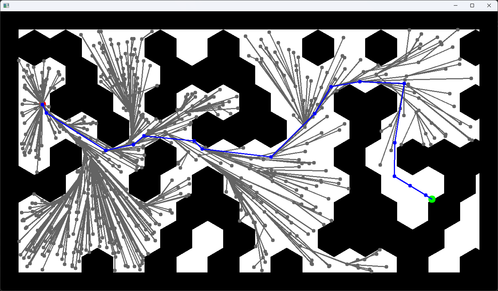
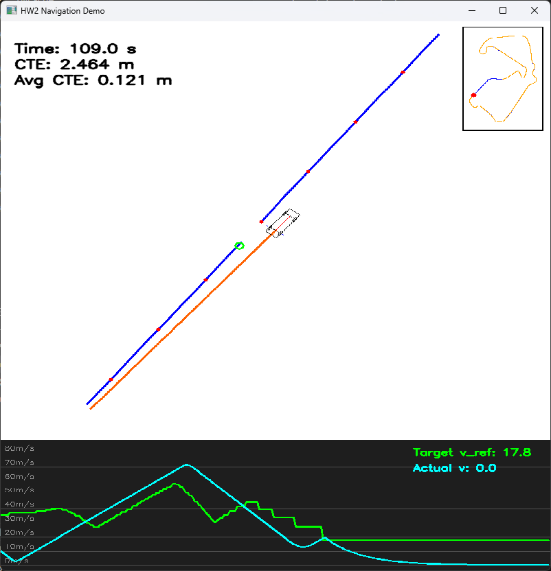
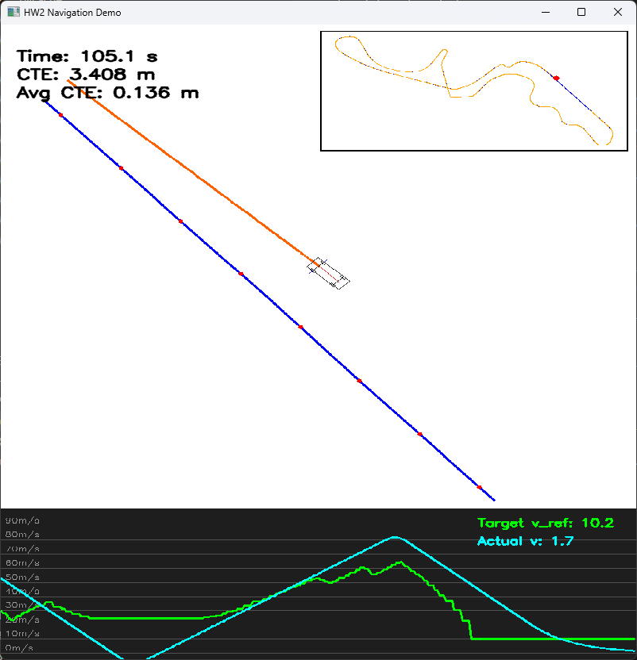
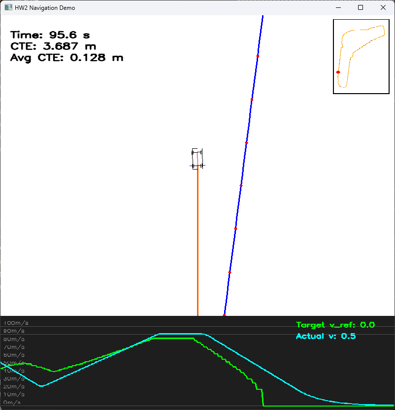

# Motion Planning & Vehicle Control

**A*, RRT*, speed-profile generation, and path tracking in simulation.**

I implemented planning and control algorithms within the course-provided framework for Robotic Navigation and Exploration (Spring 2026). The most useful outcome was understanding how error definitions, speed limits, and controller tuning change tracking behavior—not just completing a list of algorithms.

<table>
<tr><td width="50%"></td><td width="50%"></td></tr>
<tr><td>RRT* planning on an obstacle map.</td><td>Stanley tracking on Silverstone: 109.00 s, 0.1212 m average CTE in the recorded run.</td></tr>
</table>

## What I implemented

| Area | Implementation and investigation |
|---|---|
| Search-based planning | A* cost updates and frontier ordering; examined how equal-cost parent replacement changes the search-tree shape. |
| Sampling-based planning | RRT* steering, collision checks, parent selection, rewiring, and descendant-cost propagation. |
| Vehicle models | Bicycle state update and differential-drive command conversion within the supplied simulator. |
| Longitudinal control | Curvature-limited reference speed, forward/backward acceleration and braking passes, and speed-tracking PID. |
| Lateral control | PID, Pure Pursuit, Stanley, and LQR implementations and tuning within the assignment framework. |

## Recorded tracking results

The table below preserves the bicycle-model rows from my HW2 report (Table 3) and `result.md`. Each cell reports **completion time in seconds / average cross-track error in metres**. These are archived simulation runs, without repeated-trial statistics.

| Controller | Silverstone: s / m | Suzuka: s / m | Monza: s / m |
|---|---:|---:|---:|
| PID | 110.25 / 1.4196 | 107.65 / 1.3554 | 106.60 / 1.9592 |
| Pure Pursuit | **104.60** / 2.0267 | **101.90** / 1.9231 | **94.45** / 1.2368 |
| Stanley | 109.00 / **0.1212** | 105.10 / **0.1358** | 95.55 / **0.1281** |
| LQR, steering-rate input | 109.20 / 0.4407 | 105.70 / 0.5449 | 97.55 / 0.3047 |

Stanley had the lowest average cross-track error in these recorded comparisons; Pure Pursuit completed each track fastest. This illustrates the speed–tracking tradeoff under these settings, rather than establishing a universally best controller. The LQR row uses **steering angular velocity** as its input.

Stanley screenshots from all three tracks

| Silverstone | Suzuka | Monza |
|---|---|---|
|  |  |  |

The screenshots display both instantaneous `CTE` and `Avg CTE`; the table reports the latter at the precision recorded in the report.

## Design decisions and lessons

### Define lateral error relative to the path

For bicycle PID tracking, I used the signed projection onto the path normal:

`e = (x_vehicle - x_target) sin(theta_path) - (y_vehicle - y_target) cos(theta_path)`

My report describes oversteering when an error definition based on the bearing to the nearest waypoint flipped as the vehicle passed that waypoint. Referencing the path tangent addressed that behavior in the assignment experiments. The tuning log also showed that aggressive gains could reduce average error while producing visibly oscillatory motion, so average CTE alone was not enough to judge the result.

### Slow down before corners

The speed profile caps velocity using curvature and a lateral-acceleration limit. A forward pass applies the acceleration limit; a backward pass applies braking constraints so deceleration begins before a tight bend. Longitudinal PID then tracks that reference while a lateral controller steers.

### Keep RRT* costs consistent after rewiring

Reparenting a node changes the costs of its descendants. I implemented recursive cost propagation and compared runs with and without it. The report did not show a substantial visual difference in the tested case; I treat this as a cost-consistency detail, without claiming a measured planning-performance gain.

### Equal-cost choices affect A* visualization

Allowing a new parent at equal cost (`>=` rather than `>`) changed the search tree into a fishbone-like pattern, even when the final paths were similar. That distinction helped separate the visual appearance of exploration from final path quality.

## Scope and archive

These are two related assignments: obstacle-map planning in HW1 and vehicle tracking in HW2. The displayed F1 runs do not demonstrate an integrated A*/RRT* racing pipeline. The simulator, assignment structure, and supporting framework were supplied by the course; my contribution was the assigned algorithm implementation, tuning, experiments, and analysis.

- [Planning implementation](archive/planning): the two submitted algorithm files; the surrounding HW1 framework is not included.
- [Control submission](archive/control): the archived HW2 code, including course scaffolding and track data. This directory is a mixed course submission, not a claim of sole authorship of every file.
- [Source and figure index](docs/source-index.md).

Related work: [ROS 2 Autonomous Pick-and-Place Rover](https://github.com/RICHKUNG/ros2-autonomous-pick-and-place), which focuses on perception, localization, visual servoing, and mission-level decisions in Unity.
